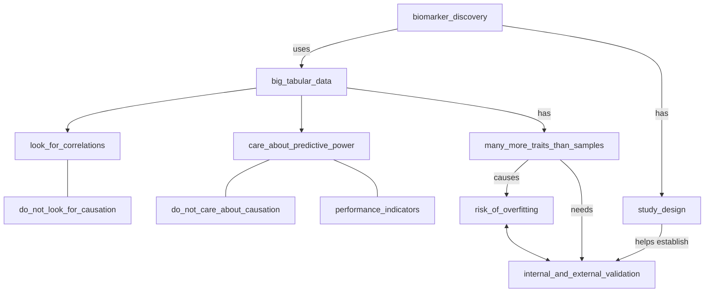

# Biomarker Discovery: from theory to real world examples

Welcome to the workshop
'Biomarker Discovery: from theory to real world examples'

- [Prerequisites](prerequisites.md)
- [FAQ](faq.md)
- [Contact us](contact_us.md)

## Old stuff

- [Communication](communication.md)

