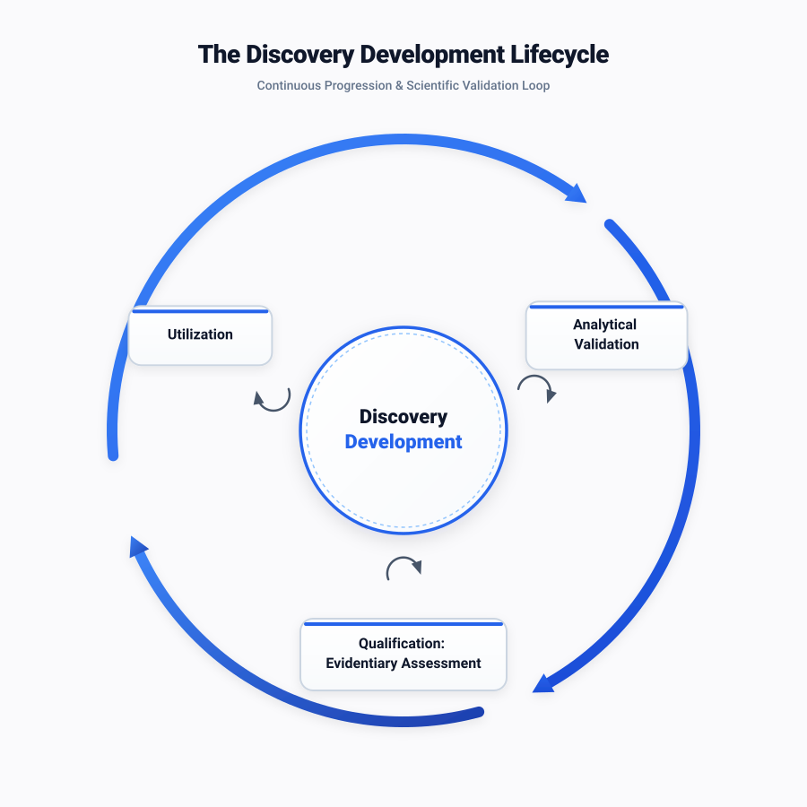
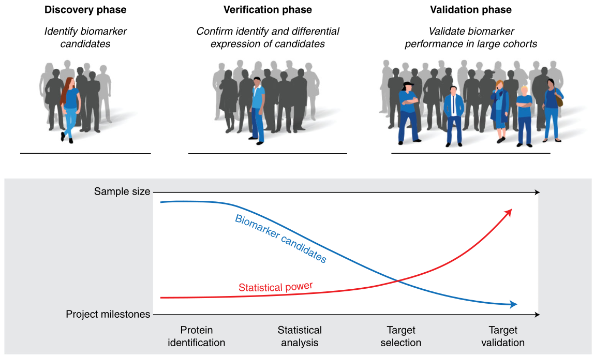
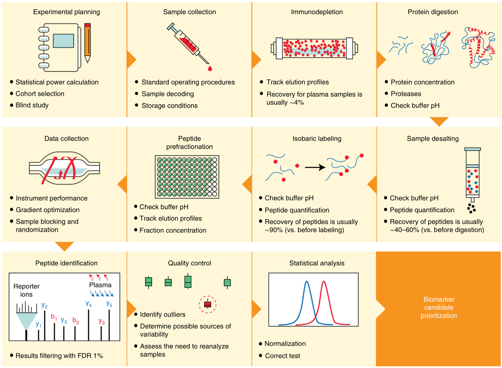
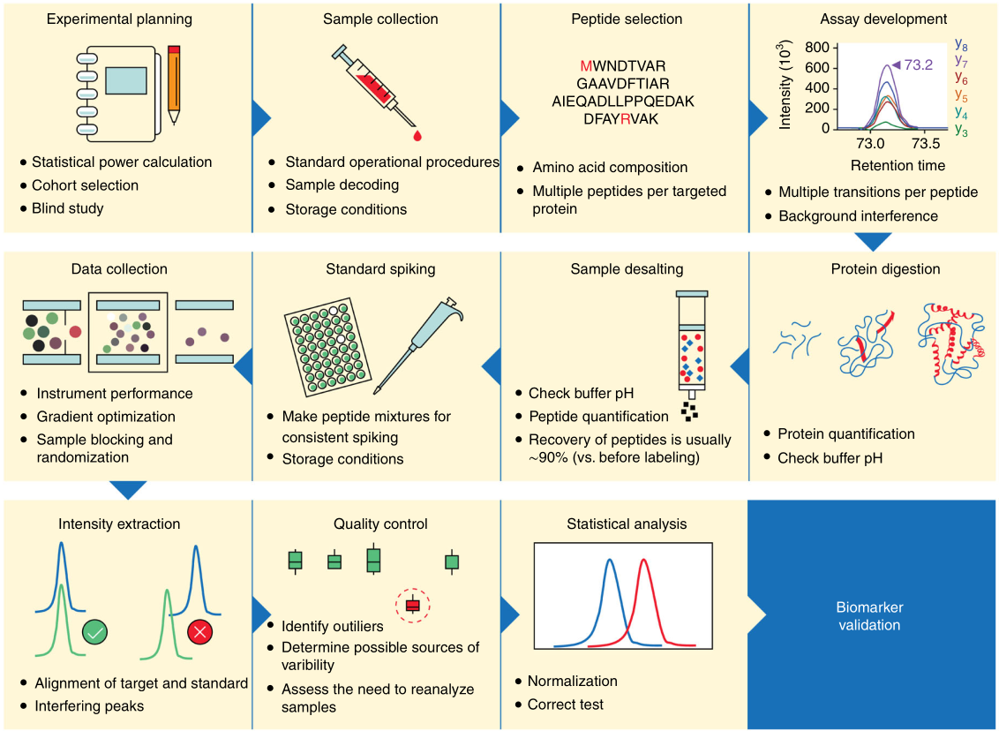
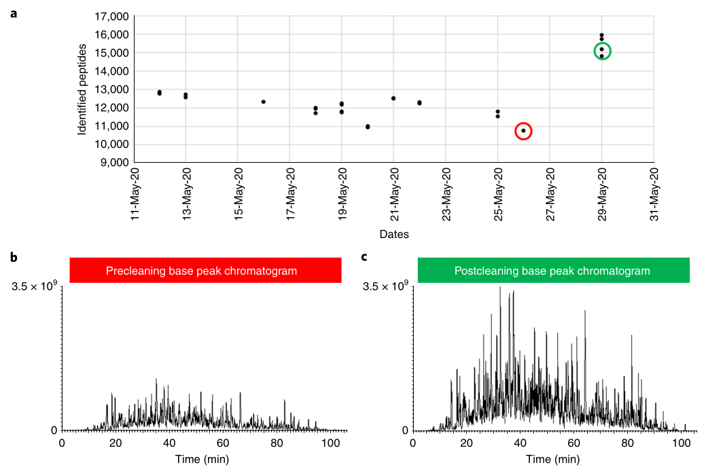

# Literature

???- info "What are the option to describe open and closed access?"

    What is my favorite way to describe open and closed access?

    

    

    :material-lock-open-variant:{ style="color: #F47D20;" }

    :material-lock-open-variant:

    :material-lock:{ style="color: #757575;" }

    :material-lock:

The literature used in this course

- :material-lock:{ style="color: #757575;" } `[Califf, 2018]`
  Califf, R. (2018).
  Biomarker definitions and their applications.
  *Experimental Biology and Medicine, 243*, 213 - 221.
  <https://doi.org/10.1177/1535370217750088>

???- info "Summary of `[Califf, 2018]`"

    This paper gives the definition and use of the types of biomarkers.
    Here are the definitions:

    - 'A diagnostic biomarker detects or confirms the presence of a
      disease or condition of interest, or identifies an individual
      with a subtype of the disease'
    - 'When a biomarker can be measured serially to assess the
      status of a disease or medical condition for evidence of
      exposure to a medical product or environmental agent, or
      to detect an effect of a medical product or biological agent,
      it is a monitoring biomarker.'
    - 'When the level of a biomarker changes in response to
      exposure to a medical product or an environmental agent, it can
      be called a pharmacodynamic/response biomarker'
    - 'A predictive biomarker is defined by the finding that the presence
      or change in the biomarker predicts an individual or
      group of individuals more likely to experience a favorable
      or unfavorable effect from the exposure to a medical
      product or environmental agent.'
    - 'A prognostic biomarker is used to identify the likelihood of a
      clinical event, disease recurrence, or disease progression in
      patients with a disease or medical condition of interest.'
    - 'A safety biomarker is measured before or after an exposure to
      a medical intervention or environmental agent to indicate
      the likelihood, presence, or extent of a toxicity as an adverse
      event.'

    Interesting quote:

    > The single most common and serious error in the evaluation
    > of biomarkers is the assumption that a correlation
    > between the measured level of a biomarker and a clinical
    > outcome means that the biomarker constitutes a valid surrogate.

    Redrawn after figure 1:

    

    > One rapidly developing frontier is the field of digital bio-
    > markers

- `[Fleming and Demets, 1996]`
  Fleming, Thomas R., and David L. DeMets.
  "Surrogate end points in clinical trials: are we being misled?."
  Annals of internal medicine 125.7 (1996): 605-613.

???- info "Summary of `[Fleming and Demets, 1996]`"

    This study provides the reasoning
    that a correlation between a biomarker and a disease outcome,
    does not prove there is a causal effect (i.e. the biomarker is no
    real surrogate for the clinical outcome)

    It is called 'a classic work' by `[Califf, 2018]`.

- `[MacLean et al., 2019]`
  MacLean, Emily, et al. 
  "A systematic review of biomarkers to detect active tuberculosis."
  Nature microbiology 4.5 (2019): 748-758.

???- info "Summary of `[MacLean et al., 2019]`"

    This study investigated 7631 tuberculosis biomarker papers
    and mention these as the problems for reproducibility:

    - most studies had a small size, i.e. they were underpowered
    - control groups were inappropriate
    - a significant p-value was used to validate a finding, instead
      of validation experiments
    - the blindedness (as in 'single-blinded') of an experiment
      was not mentioned

    discovery, verification and validation

- :material-lock:{ style="color: #757575;" } `[Nakayasu et al., 2021]`
  Nakayasu, E., Gritsenko, M., Piehowski, P.,
  Gao, Y.-Q., Orton, D., Schepmoes, A., Fillmore, T., Frohnert, B.,
  Rewers, M., Krischer, J., Ansong, C., Suchy-Dicey, A. M.,
  Evans-Molina, C., Qian, W., Webb-Robertson, B., & Metz, T. (2021).
  Tutorial: best practices and considerations for mass-spectrometry-based
  protein biomarker discovery and validation.
  *Nature protocols, 16*, 3737 - 3760.
  <https://doi.org/10.1038/s41596-021-00566-6>

???- info "Summary of `[Nakayasu et al., 2021]`"

    This paper describes how to design and implementing a
    liquid-chromatography-mass-spectrometry-based biomarker discovery,
    with a focus on lab-work.

    There are three phases in biomarker discovery:

    Phase|Name
    -----|----------------------------------------------------------
    1    |Discovery
    2    |Verification
    3.1  |Validation step 1: analytical validation
    3.2  |Validation step 2: clinical validation, aka qualification

    

    For analytical validation one needs to establish:

    - precision
      - measure of repeatability, i.e. within-day variability
      - measure of reproducibility, i.e. day-to-day variabilty
    - specificity
    - sensitivity
    - recovery
    - stability

    

    

    One of my favorite figures is the effect of cleaning your
    equipment. The authors of this paper, in their lab, run a same
    sample before and/or after each run, in which less and less peptides
    get detected. If the threshold is too low, the machine is cleaned and
    its sensitivity increases:

    

- `[Prentice, 1989]` Prentice, Ross L.
  "Surrogate endpoints in clinical trials: definition and operational criteria."
  Statistics in medicine 8.4 (1989): 431-440.

???- info "Summary of `[Prentice, 1989]`"

    This study provides the reasoning
    that a correlation between a biomarker and a disease outcome,
    does not prove there is a causal effect (i.e. the biomarker is no
    real surrogate for the clinical outcome)

    It is called 'a classic work' by `[Califf, 2018]`.

- :material-lock:{ style="color: #757575;" } `[Rifai et al., 2006]`
  Rifai, N., Gillette, M., & Carr, S. (2006).
  Protein biomarker discovery and validation:
  the long and uncertain path to clinical utility.
  *Nature Biotechnology, 24*, 971-983.
  <https://doi.org/10.1038/nbt1235>

???- info "Summary of `[Rifai et al., 2006]`"

    The paper describes biomarker discovery experiments
    based on liquid-chromatography-mass-spectrometry analysis
    of human clinical samples,
    with a focus on lab work.

    Unsure if this is relevant
