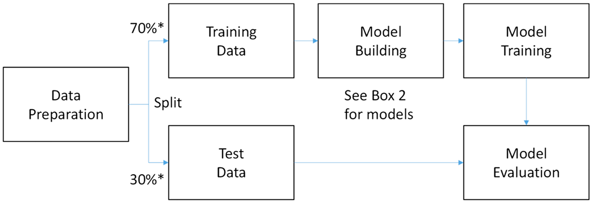
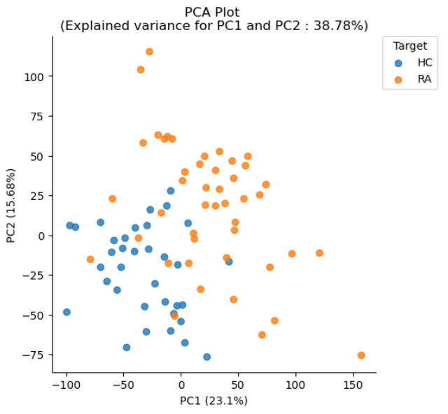
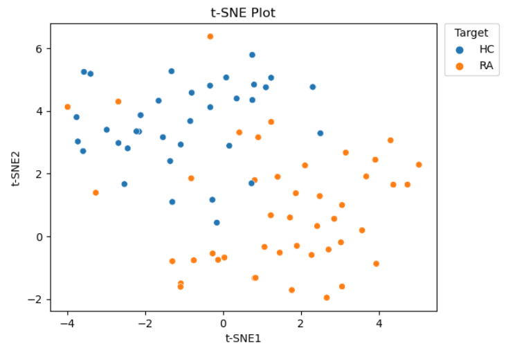
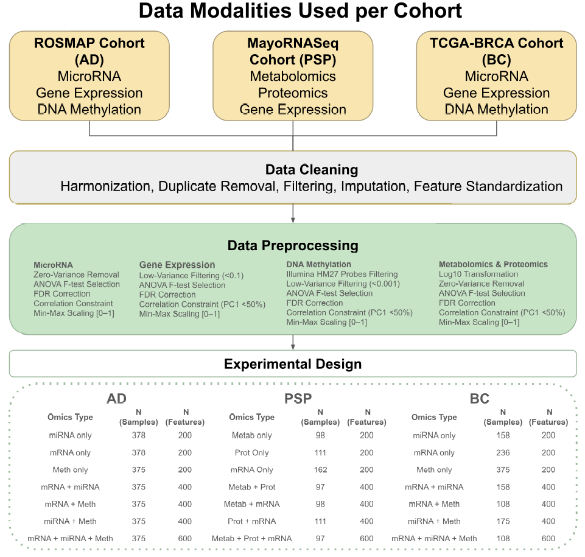
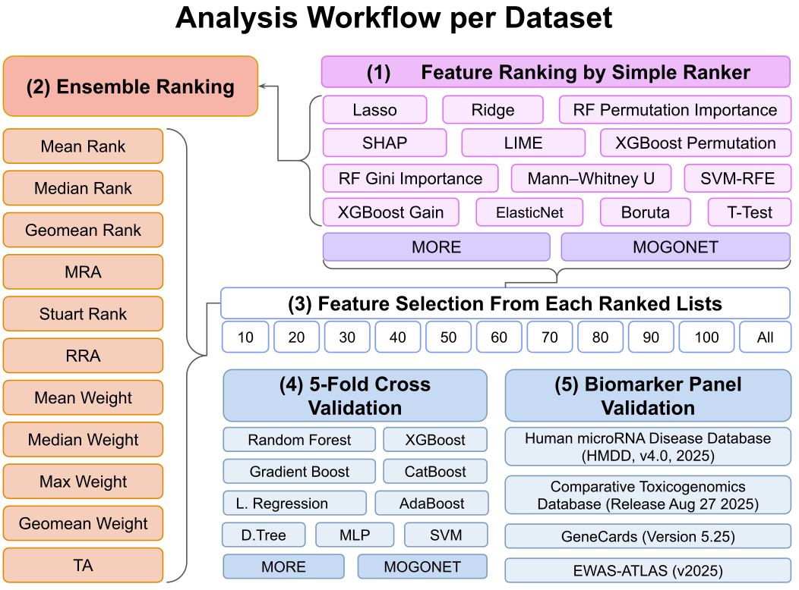

# Literature

???- info "What are the option to describe open and closed access?"

    Option                                                                                                 |Verdict
    -------------------------------------------------------------------------------------------------------|------------
    :material-lock-open-variant:{ style="color: #F47D20;" }                                                | My favorite
    :material-lock:{ style="color: #757575;" }                                                             | My favorite
      | Neh
                | Neh
    :material-lock-open-variant:                                                                           | Simplest
    :material-lock:                                                                                        | Simplest

The literature used in this course

- :material-lock:{ style="color: #757575;" } `[Califf, 2018]`
  Califf, R. (2018).
  Biomarker definitions and their applications.
  *Experimental Biology and Medicine, 243*, 213 - 221.
  <https://doi.org/10.1177/1535370217750088>

???- info "Summary of `[Califf, 2018]`"

    This paper gives the definition and use of the types of biomarkers.
    Here are the definitions:

    - 'A diagnostic biomarker detects or confirms the presence of a
      disease or condition of interest, or identifies an individual
      with a subtype of the disease'
    - 'When a biomarker can be measured serially to assess the
      status of a disease or medical condition for evidence of
      exposure to a medical product or environmental agent, or
      to detect an effect of a medical product or biological agent,
      it is a monitoring biomarker.'
    - 'When the level of a biomarker changes in response to
      exposure to a medical product or an environmental agent, it can
      be called a pharmacodynamic/response biomarker'
    - 'A predictive biomarker is defined by the finding that the presence
      or change in the biomarker predicts an individual or
      group of individuals more likely to experience a favorable
      or unfavorable effect from the exposure to a medical
      product or environmental agent.'
    - 'A prognostic biomarker is used to identify the likelihood of a
      clinical event, disease recurrence, or disease progression in
      patients with a disease or medical condition of interest.'
    - 'A safety biomarker is measured before or after an exposure to
      a medical intervention or environmental agent to indicate
      the likelihood, presence, or extent of a toxicity as an adverse
      event.'

    Interesting quote:

    > The single most common and serious error in the evaluation
    > of biomarkers is the assumption that a correlation
    > between the measured level of a biomarker and a clinical
    > outcome means that the biomarker constitutes a valid surrogate.

    Redrawn after figure 1:

    

    > One rapidly developing frontier is the field of digital bio-
    > markers

- `[Dhillon et al., 2022]` Dhillon, A., Singh, A., & Bhalla, V. (2022). A Systematic Review on Biomarker Identification for Cancer Diagnosis and Prognosis in Multi-omics: From Computational Needs to Machine Learning and Deep Learning. *Archives of Computational Methods in Engineering, 30*, 917-949. <https://doi.org/10.1007/s11831-022-09821-9>

- `[Fleming and Demets, 1996]`
  Fleming, Thomas R., and David L. DeMets.
  "Surrogate end points in clinical trials: are we being misled?."
  Annals of internal medicine 125.7 (1996): 605-613.

???- info "Summary of `[Fleming and Demets, 1996]`"

    This study provides the reasoning
    that a correlation between a biomarker and a disease outcome,
    does not prove there is a causal effect (i.e. the biomarker is no
    real surrogate for the clinical outcome)

    It is called 'a classic work' by `[Califf, 2018]`.

- `[MacLean et al., 2019]`
  MacLean, Emily, et al. 
  "A systematic review of biomarkers to detect active tuberculosis."
  Nature microbiology 4.5 (2019): 748-758.

???- info "Summary of `[MacLean et al., 2019]`"

    This study investigated 7631 tuberculosis biomarker papers
    and mention these as the problems for reproducibility:

    - most studies had a small size, i.e. they were underpowered
    - control groups were inappropriate
    - a significant p-value was used to validate a finding, instead
      of validation experiments
    - the blindedness (as in 'single-blinded') of an experiment
      was not mentioned

    discovery, verification and validation

- :material-lock:{ style="color: #757575;" } `[Nakayasu et al., 2021]`
  Nakayasu, E., Gritsenko, M., Piehowski, P.,
  Gao, Y.-Q., Orton, D., Schepmoes, A., Fillmore, T., Frohnert, B.,
  Rewers, M., Krischer, J., Ansong, C., Suchy-Dicey, A. M.,
  Evans-Molina, C., Qian, W., Webb-Robertson, B., & Metz, T. (2021).
  Tutorial: best practices and considerations for mass-spectrometry-based
  protein biomarker discovery and validation.
  *Nature protocols, 16*, 3737 - 3760.
  <https://doi.org/10.1038/s41596-021-00566-6>

???- info "Summary of `[Nakayasu et al., 2021]`"

    This paper describes how to design and implementing a
    liquid-chromatography-mass-spectrometry-based biomarker discovery,
    with a focus on lab-work.

    There are three phases in biomarker discovery:

    Phase|Name
    -----|----------------------------------------------------------
    1    |Discovery
    2    |Verification
    3.1  |Validation step 1: analytical validation
    3.2  |Validation step 2: clinical validation, aka qualification

    

    For analytical validation one needs to establish:

    - precision
      - measure of repeatability, i.e. within-day variability
      - measure of reproducibility, i.e. day-to-day variabilty
    - specificity
    - sensitivity
    - recovery
    - stability

    

    

    One of my favorite figures is the effect of cleaning your
    equipment. The authors of this paper, in their lab, run a same
    sample before and/or after each run, in which less and less peptides
    get detected. If the threshold is too low, the machine is cleaned and
    its sensitivity increases:

    

<!-- Ng et al., 2023 ---------------------------------------------------------->

- :material-lock-open-variant:{ style="color: #F47D20;" } `[Ng et al., 2023]`
  Ng, S., Masarone, S., Watson, D., & Barnes, M. R. (2023).
  The benefits and pitfalls of machine learning for biomarker discovery.
  *Cell and Tissue Research, 394*, 17 - 31.
  <https://doi.org/10.1007/s00441-023-03816-z>

???- info "Summary of `[Ng et al., 2023]`"

    This paper makes the case for explainable AI
    and illustrates this with a case study.

    ...

    It demonstrates how to setup a machine-learning experiment:

    

    It also describes how to evaluate the performance of a supervised
    machine learning model:

    - Accuracy or F1 score
    - Receiver-operator-characteristic ('ROC') score

    Problem is that the interpretation of the results is harder too do.

    The paper also mentions the problem that there are many more dimensions
    in the data as there are patients.

    The paper makes the case for Explainable AI (XAI). There are two
    approaches:

    - intrinsic XAI methods: uses only methods that can explain their findings,
      such as linear regression, logistic regression and decision trees
    - post-hoc XAI: explain findings of other methods

    The paper has a section called 'Correlation or causation?',
    about C-reactive protein (CRP) as a biomarker. Its relation
    to cardiovascular disease was unclear. It correlated with
    the disease and was used as an inflammatory biomarker
    (this doubt was already present in 1999).
    Later research showed that this protein reaches higher levels
    before (and during) the disease and is since 2000 used as a 
    predictor biomarker.

    The paper describes a study of asthma with multiple endotypes (i.e.
    different pathways to reach the same phenotypes) that will need
    different types of treatments.

    The paper supplies [a Jupyer notebook](https://github.com/C4TB/CTR_XAI)
    on a single-omics dataset
    and compare the differences of PCA and t-SNE:

    

    

<!-- Njume et al., 2026 ------------------------------------------------------->

- :material-lock-open-variant:{ style="color: #F47D20;" } `[Njume et al., 2026]`
  Njume, C. M., Petracci, I., Bellini, S., Goljanek‐Whysall, K., Quinlan, L. R.,
  Fiszer, A., Borroni, B., Ghidoni, R., Kumbasar, A., & Çakmak, A. (2026).
  When complexity does not pay: benchmarking deep learning and ensemble methods
  for biomarker discovery. *Briefings in Bioinformatics, 27*.
  <https://doi.org/10.1093/bib/bbag211>

???- info "Summary of `[Njume et al., 2026]`"

    A benchmark paper, that used 3 different datasets, 
    27 feature selection strategies, 11 predictive models
    and concluded that (1) simpler classifiers are typically just as
    useful as deep learning models, (2) Combining three omics sets
    yielded a higher validation when using two or one omics set.

    Multi-omics data analysis has two main problems: (1) a dataset
    has more dimentions that samples, allowing overfitting, (2) the different
    types of data have differt data types, (3) limited availability
    of this sensitive data

    > it remains unclear whether increasing
    > methodological complexity consistently yields more reliable and
    > interpretable biomarker panels, or whether simpler and ensemble-
    > based approaches may offer equal or greater robustness

    The study uses these publicly available datasets:

    - ROSMAP (Alzheimer's Disease)
    - MayoRNASeq (progressive supranuclear palsy, a brain disease)
    - TCGA-BRCA (breast cancer)

    

    

    Code at [its GitHub repository](https://github.com/itu-bioinformatics-database-lab/biomarker-benchmark)

<!-- Prentice, 1989 ----------------------------------------------------------->

- `[Prentice, 1989]` Prentice, Ross L.
  "Surrogate endpoints in clinical trials: definition and operational criteria."
  Statistics in medicine 8.4 (1989): 431-440.

???- info "Summary of `[Prentice, 1989]`"

    This study provides the reasoning
    that a correlation between a biomarker and a disease outcome,
    does not prove there is a causal effect (i.e. the biomarker is no
    real surrogate for the clinical outcome)

    It is called 'a classic work' by `[Califf, 2018]`.

<!-- Rifai et al., 2006 ------------------------------------------------------->

- :material-lock:{ style="color: #757575;" } `[Rifai et al., 2006]`
  Rifai, N., Gillette, M., & Carr, S. (2006).
  Protein biomarker discovery and validation:
  the long and uncertain path to clinical utility.
  *Nature Biotechnology, 24*, 971-983.
  <https://doi.org/10.1038/nbt1235>

???- info "Summary of `[Rifai et al., 2006]`"

    The paper describes biomarker discovery experiments
    based on liquid-chromatography-mass-spectrometry analysis
    of human clinical samples,
    with a focus on lab work.

<!-- Zhang et al., 2025 ------------------------------------------------------->

- `[Zhang et al., 2025]`
  Zhang, Xinyang, Ali Rahnavard, and Keith A. Crandall. 
  "Machine learning enhances biomarker discovery:
  From multi-omics to functional genomics." Medical Research Archives 8 (2025).
  [DOI](https://doi.org/10.18103/mra.v13i8.6888)

???- info "Summary of `[Zhang et al., 2025]`"

    ...
