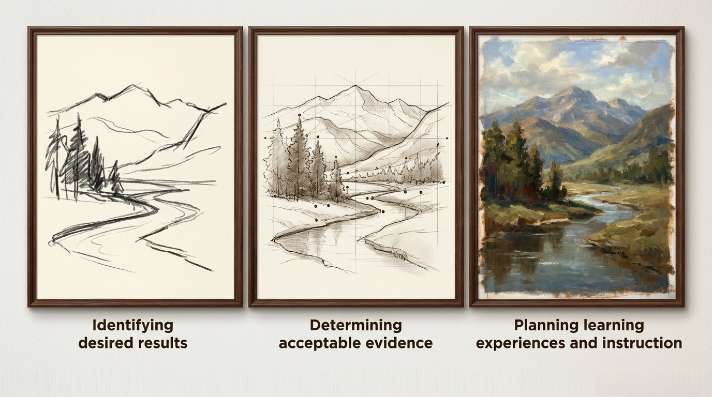
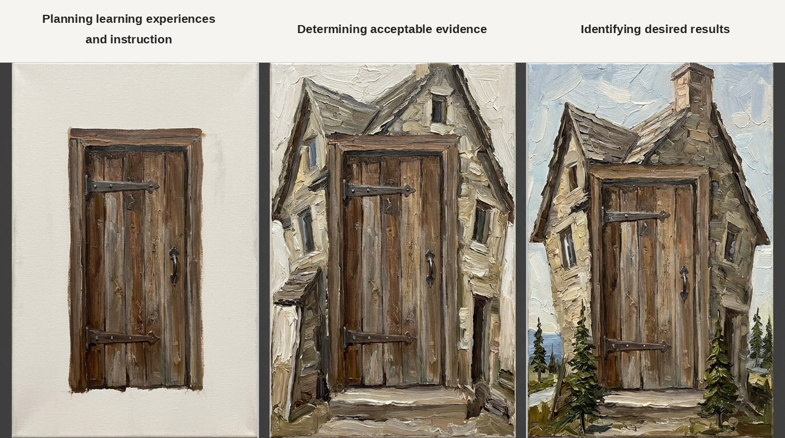

## 2026-11-27 11:00-12:00

Richel's questions to Prasoon:

## Identifying desired results

- Here is a draft course goal:
  'To discover biomarkers and evaluate the findings for correctness,
  using computational approaches,
  starting from a research question'.
  What do you think should be added/changed?
- Does the course teach how to verify and validate a biomarker?
  The title states only 'Discovery', not these two next steps
- About this statement: 'At the heart of the method, biomarker discovery
  is analysing tabular data for correlations that allow for robust
  predictions'. Would you agree with this?
  If yes, what is it -according to you- that is so hard about
  biomarker discovery? I guess that this should be in the course :-) 
- You stated 'I will possibly will have some more information on the datasets
  that we can use'. How does this work with the 'starting from a research
  question' approach?

## Determining acceptable evidence

- During the course,
  what should we see our learners do to make us say we did a good job?
- When evaluating the course for ourselves,
  what makes us say we did a good job? What should we see/ask/etc?

## Planning learning experiences and instruction

- Do you agree to limit lectures to 10 minutes? If not, which length?
- Will the course use only multi-omics datasets (i.e. and
  not use single-omics)? Why?

## Administrative

- Where is all the other course material (i.e. that not in the GitHub
  repository)? Can I upload it?
- Could I have the earlier course evaluations? Can I upload them?
- Where is the course? Online, in real life, of hybrid?

On a different note, I saw you teach in the Epigenetics course,
which was 1 hour of lecturing. It confused me:
we want our course to be interactive,
so I fail to understand why you lectured.
Can I assume it was social/political/limited-time reasons that you lectured?

